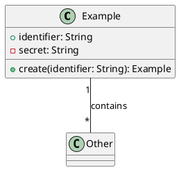

# FR-C3-02 Design Understanding and Stack Selection

This document records the implemented Component 3 methodology. It describes a
deterministic research prototype, not validated experimental results. All C1
and C2 contracts remain provisional until their owning team members confirm
them.

## Processing boundary

`DesignUnderstandingService` accepts only an immutable `GenerationContext`.
The API representation can still be submitted by a caller, so this type
boundary is not cryptographic proof that `/validate-input` produced it. Future
integration needs trusted artifact identity, storage, and issuer verification.

The service preserves without rewriting:

- C1 requirement IDs, titles, approval states, SRS version, and opaque
  approval/validation references;
- C2 UML version, every released UML ID and source artifact, validation-report
  reference, and requirement-to-UML anchor; and
- C2 structured UI/wireframe IDs and source references.

It does not add requirements, infer missing members, rename design elements,
or re-run C2's authoritative UML semantic validation.

## Supported PlantUML subset

Only C2 UML elements labeled `CLASS` or `CLASS_DIAGRAM` are parsed. They must
contain a `plantuml_source` document bounded by `@startuml` and `@enduml`.

Supported syntax is intentionally limited to:



Supported members are attributes (`visibility name: Type`) and methods
(`visibility name(parameter: Type): ReturnType`). Supported visibility markers
are `+`, `-`, `#`, and `~`. Supported relationship connectors are `--`, `-->`,
`<--`, `..>`, `<..`, `*--`, `--*`, `o--`, `--o`, `<|--`, and `--|>`.

| Construct | Task 4 status | Behaviour |
| --- | --- | --- |
| `class Name` and `class Name { ... }` | Supported | Produces a normalized class with preserved UML provenance. |
| Attributes and methods in the documented member grammar | Supported | Parsed without inventing missing types or members. |
| Relationships using the listed connectors | Supported | Both endpoints must name classes declared in the same parsed diagram. |
| `interface` | Unsupported | Fails explicitly; it is not converted into a class. |
| `enum` | Unsupported | Fails explicitly; enum members are not interpreted. |
| `abstract class` | Unsupported | Fails explicitly; abstract semantics are not discarded. |
| `package` or `namespace` | Unsupported | Fails explicitly; nested naming and scope are not guessed. |

Blank lines and comments beginning with `'` or `//` are ignored. Unsupported
constructs fail explicitly rather than being guessed. Examples include
interfaces, enums, abstract classes, packages, namespaces, stereotypes,
annotations, notes, macros/includes, skin parameters, generic relationship
syntax outside the list above, and complex class-member modifiers.

At least one class diagram, PlantUML source, and class definition are required.
Unclosed documents or class bodies, duplicate class definitions, malformed
members, and relationships to undefined classes also fail explicitly.

These restrictions are parser boundaries only; they do not state that the UML
is semantically correct.

## Stack candidates

The service always evaluates exactly these four candidates:

1. React + Node.js
2. Angular + Node.js
3. React + Spring Boot
4. Angular + Spring Boot

Generator availability is excluded from scoring and reported after selection.
Task 6 now reports React + Node.js as `IMPLEMENTED` for its narrow Task
Management generation MVP. Angular + Node.js, React + Spring Boot, and Angular
+ Spring Boot remain `NOT_IMPLEMENTED`. Availability does not alter selection
scores. An unavailable selection is returned honestly and is never replaced
silently.

## Hard compatibility constraints

The constraint list and its interpretation are **PROVISIONAL RESEARCH POLICY
ASSUMPTIONS** requiring researcher approval. They are configured policy, not
facts measured from the submitted design.

A candidate is ineligible when any of these conditions applies:

- it does not match an explicitly required frontend or backend;
- it contains an explicitly prohibited technology;
- its Node or JVM backend runtime is unavailable; or
- static SPA delivery is unavailable.

If all four candidates are ineligible, selection fails with
`NO_COMPATIBLE_STACK` and HTTP 409.

## Criteria, weights, and formula

All weights in policy version `1.0` are **PROVISIONAL RESEARCH POLICY
ASSUMPTIONS**. The implementation and this document use the following values;
this transparency change does not alter them:

| Criterion | Weight | Purpose |
| --- | ---: | --- |
| Requirement fit | 0.35 | Prioritizes stated required and preferred technology needs. |
| Architectural fit | 0.25 | Applies the declared architecture-style compatibility policy. |
| Team fit | 0.20 | Uses caller-supplied normalized team proficiency evidence. |
| Deployment compatibility | 0.20 | Uses runtime availability and deployment preference. |

The weights sum to 1.0. Requirement fit is highest because violating or
weakly matching stated needs creates the greatest semantic risk. Architecture
is next because it affects system structure. Team and deployment are equally
weighted operational constraints. This ordering is not an empirical result and
requires researcher approval.

Each raw criterion score is in `[0, 1]`. Each criterion also requires an
evidence reference and confidence in `[0, 1]`. Uncertainty is applied as:

```text
uncertainty_adjusted_score_i = raw_score_i × confidence_i
weighted_score_i = uncertainty_adjusted_score_i × weight_i
normalized_candidate_score = sum(weighted_score_i)
```

The resulting candidate score remains in `[0, 1]`. Every confidence value and
the choice to multiply by confidence are **PROVISIONAL RESEARCH POLICY
ASSUMPTIONS**. Lower confidence therefore reduces the contribution of
uncertain evidence; it is not an independently verified probability.

Requirement preferences score `1.0` for a match and `0.5` for a mismatch; no
soft preference is neutral at `1.0`. Team fit is the mean of supplied frontend
and backend proficiency. Deployment fit is `1.0` for the preferred or an
unspecified backend runtime and `0.6` otherwise, after hard compatibility.
The match, mismatch, neutral, preferred-runtime, and non-preferred-runtime
values are all **PROVISIONAL RESEARCH POLICY ASSUMPTIONS**.

Architecture compatibility uses the following explicit policy matrix:

| Architecture | React | Angular | Node.js | Spring Boot |
| --- | ---: | ---: | ---: | ---: |
| Rapid MVP | 0.95 | 0.75 | 0.95 | 0.65 |
| REST SPA | 0.90 | 0.90 | 0.90 | 0.90 |
| Enterprise layered | 0.80 | 0.95 | 0.70 | 1.00 |

Every architecture score in this matrix is a **PROVISIONAL RESEARCH POLICY
ASSUMPTION**. These values are transparent policy priors, not measured
performance or quality claims. The automated sensitivity test demonstrates
that a different valid weight set can change the selected candidate; it does
not validate which weights are scientifically correct.

## Determinism and tie-breaking

Candidates are evaluated in the listed canonical order. Scores are rounded to
six decimal places. Equal scores use that same order as the deterministic
tie-break: React+Node.js, Angular+Node.js, React+Spring Boot, then
Angular+Spring Boot. Generator availability never participates in the tie.
The six-decimal rounding choice and canonical tie priority are **PROVISIONAL
RESEARCH POLICY ASSUMPTIONS** requiring researcher approval.

## Report transparency

The versioned report separates these concerns instead of presenting policy
values as observed facts:

- `observed_input_evidence` records caller-supplied criteria, references, and
  proficiency values. References are labeled `CALLER_SUPPLIED_UNVERIFIED`.
- `configured_scoring_assumptions` exposes the weights, complete architecture
  matrix, preference/deployment values, confidence method, hard constraints,
  tie order, and rounding choice. The section is labeled
  `PROVISIONAL_RESEARCH_POLICY_ASSUMPTIONS`.
- `candidate_calculations` contains all four candidates in canonical order,
  including ineligible candidates. Each exposes four raw scores, weights,
  confidence values, uncertainty-adjusted scores, weighted scores, evidence
  references, constraint failures, and the final normalized score.
- `uncertainty` states that evidence references were not verified and explains
  the effect of each configured confidence value.
- `researcher_approval` remains `PENDING_RESEARCHER_APPROVAL` and lists the
  decisions that cannot be treated as approved by the algorithm.

The selected candidate and three rejected alternatives remain in the report
for convenient decision review. Generator status and the October 21 MVP target
flag are reported but never affect scoring.

## Known methodology uncertainties

- Real C1/C2 schemas, trust mechanisms, and PlantUML release packaging are not
  approved yet.
- Requirement titles alone are insufficient to derive technology constraints;
  the selection request therefore requires explicit human-supplied criteria
  and evidence references.
- Evidence references are opaque and are not independently authenticated.
- Confidence values, team proficiency values, weights, compatibility scores,
  and tie priority are judgment-based inputs or policy assumptions.
- The parser covers only a small documented PlantUML subset and may reject
  valid C2 diagrams that use richer syntax.
- No generator-quality, performance, maintainability, cost, or deployment
  experiment has been run by this feature.

## Research review checklist

The researcher or authorized reviewer must complete and record this review
before treating the policy or its result as approved:

- [ ] Confirm the real C1/C2 contract fields and PlantUML artifact packaging.
- [ ] Confirm that the supported PlantUML subset covers the intended MVP
  diagrams, including the deliberate rejection of interface, enum, abstract
  class, package, and namespace constructs.
- [ ] Verify requirement preferences, hard constraints, architecture style,
  runtime availability, team proficiency, and evidence references.
- [ ] Approve or revise all four weights and confirm that they sum to `1.0`.
- [ ] Approve or revise every architecture compatibility matrix value.
- [ ] Approve or revise preference and deployment match/mismatch values.
- [ ] Approve the supplied confidence values and the multiplicative confidence
  method, acknowledging that Component 3 does not authenticate the evidence.
- [ ] Approve or revise the six-decimal rounding and deterministic tie order.
- [ ] Review sensitivity-test results and record why the chosen policy is
  acceptable for the research evaluation.
- [ ] Inspect all four candidate calculations, hard-constraint failures, and
  selected/rejected explanations.
- [ ] Explicitly approve the selected stack before downstream generation.
- [ ] Stop if the selected stack reports `NOT_IMPLEMENTED`. Task 6 implements
  only the narrow React + Node.js Task Management generator, and it must never
  be substituted automatically for another selected stack.

## API demonstration sequence

Start the API and open <http://127.0.0.1:8000/docs>. Use this sequence:

1. Submit the simulated package to `POST /api/v1/validate-input`.
2. Copy its `GenerationContext` response into `POST /api/v1/design-context`.
3. Copy the resulting `DesignContext` into the `design_context` field of
   `POST /api/v1/stack-selection`.
4. Supply manually reviewed criteria and evidence similar to:

```json
{
  "required_frontend": null,
  "required_backend": null,
  "preferred_frontend": "REACT",
  "preferred_backend": "NODE_JS",
  "prohibited_technologies": [],
  "architecture_style": "RAPID_MVP",
  "team_proficiency": {
    "react": 0.8,
    "angular": 0.4,
    "node_js": 0.8,
    "spring_boot": 0.5
  },
  "available_backend_runtimes": ["NODE", "JVM"],
  "supports_static_spa": true,
  "preferred_backend_runtime": "NODE",
  "evidence": {
    "requirements": {
      "reference": "SIMULATED-REQUIREMENTS-EVIDENCE",
      "confidence": 0.8,
      "uncertainty_notes": "Pending C1 confirmation"
    },
    "architecture": {
      "reference": "SIMULATED-ARCHITECTURE-EVIDENCE",
      "confidence": 0.8
    },
    "team": {
      "reference": "SIMULATED-TEAM-SKILL-ASSESSMENT",
      "confidence": 0.6
    },
    "deployment": {
      "reference": "SIMULATED-DEPLOYMENT-PROFILE",
      "confidence": 0.7
    }
  }
}
```

The labels above are intentionally simulated and must not be presented as real
team or project evidence.
