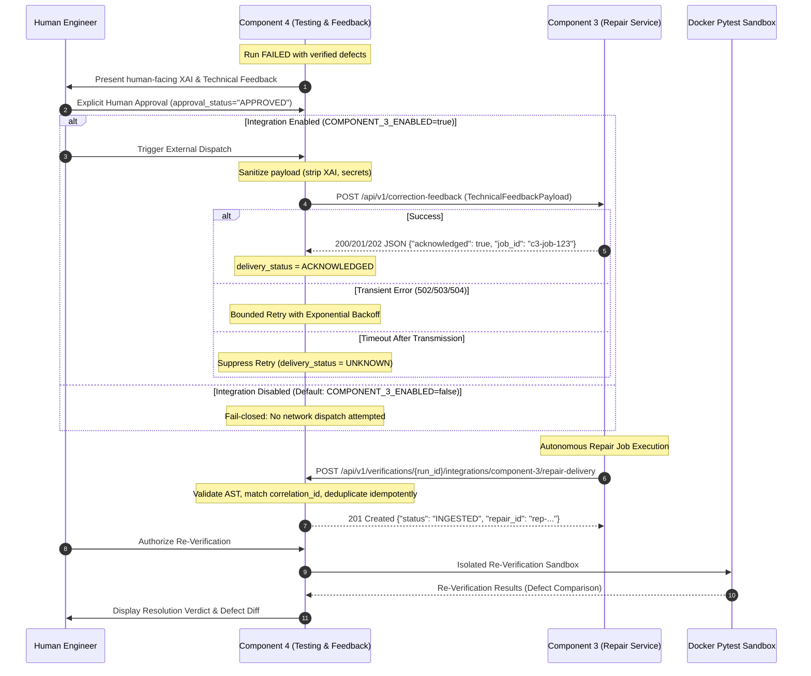

# INTELISE Component 4 — Component 3 Integration Contract & Readiness Guide

## 1. Overview and Architecture

Component 4 (**Intelligent Agentic Testing & Feedback Loop Assistant**) is responsible for automated defect verification, test execution, root-cause defect analysis, human-facing Explainable AI (XAI) diagnostics, and closed-loop repair verification.

Component 3 (**Code Generation & Automated Repair Service**) is being developed independently to ingest diagnostic feedback and generate code fixes.

This document specifies the formalized API contracts, delivery safeguards, mock testing procedures, and activation requirements governing communication between Component 4 and Component 3.



---

## 2. API Contracts: Outbound & Inbound

### 2.1 Outbound Contract: Component 4 to Component 3

- **Target Endpoint (Proposed Component 3 Route)**: `POST /api/v1/correction-feedback`
- **Headers**:
  - `Content-Type: application/json`
  - `Authorization: Bearer <COMPONENT_3_API_KEY>`
  - `X-Correlation-ID: <correlation_id>`
  - `Idempotency-Key: <dispatch_id>`

#### Field Classification Table

| Field Name | Type | Component Status | Purpose & Description |
| :--- | :--- | :--- | :--- |
| `feedback_id` | `string` | **Confirmed (C4)** | Unique technical feedback package ID (`fb-...`) |
| `verification_run_id` | `string` | **Confirmed (C4)** | ID of the failing verification run (`run-...`) |
| `submission_id` | `string` | **Confirmed (C4)** | ID of the original submitted code (`sub-...`) |
| `feedback_iteration_id` | `string` | **Confirmed (C4)** | Specific feedback cycle ID (`iter-...`) |
| `correlation_id` | `string` | **Proposed (C4 ↔ C3)**| End-to-end trace ID passed back in repair response |
| `verification_status` | `string` | **Confirmed (C4)** | Verification outcome (`FAILED` or `ERROR`) |
| `affected_files` | `list[string]` | **Confirmed (C4)** | Source code files confirmed in failure |
| `failed_tests` | `list[string]` | **Confirmed (C4)** | Exact pytest test names that failed |
| `failed_assertions` | `list[string]` | **Confirmed (C4)** | Raw failed assertions from pytest output |
| `value_comparisons` | `list[object]` | **Confirmed (C4)** | Structured expected vs. observed comparisons |
| `error_logs` | `list[string]` | **Confirmed (C4)** | Bounded traceback excerpts (max 15 lines/500 chars) |
| `test_failure_details` | `list[object]` | **Confirmed (C4)** | Per-test execution metadata, duration, error message |
| `defect_ids` | `list[string]` | **Confirmed (C4)** | Correlated defect IDs (`def-...`) |
| `evidence_references` | `object` | **Confirmed (C4)** | Deterministic telemetry (`total_tests`, `exit_code`) |
| `generated_at` | `string` | **Confirmed (C4)** | ISO 8601 UTC timestamp of feedback generation |
| `schema_version` | `string` | **Confirmed (C4)** | Contract version (`"1.0"`) |

> [!NOTE]
> **Confirmed Component 4 Fields**: Fully supported and synthesized directly from Docker pytest telemetry.
> **Proposed Fields**: `correlation_id` and acknowledgment structure require formal bilateral agreement with Component 3.

#### Illustrative Example Outbound Request (For Illustration Only — Not Real Execution Data)

```json
{
  "feedback_id": "fb-illustrative-001",
  "verification_run_id": "run-illustrative-001",
  "submission_id": "sub-illustrative-001",
  "feedback_iteration_id": "iter-illustrative-001",
  "correlation_id": "corr-illustrative-001",
  "verification_status": "FAILED",
  "affected_files": [
    "calculator.py"
  ],
  "failed_tests": [
    "test_divide_by_zero"
  ],
  "failed_assertions": [
    "ZeroDivisionError not raised by divide(10, 0)"
  ],
  "value_comparisons": [
    {
      "test_name": "test_divide_by_zero",
      "expected": "ZeroDivisionError",
      "observed": "None (returned 0)"
    }
  ],
  "error_logs": [
    "def test_divide_by_zero():\n>       with pytest.raises(ZeroDivisionError):\nE       Failed: DID NOT RAISE <class 'ZeroDivisionError'>"
  ],
  "test_failure_details": [
    {
      "test_name": "test_divide_by_zero",
      "outcome": "failed",
      "duration": 0.002,
      "message": "ZeroDivisionError not raised"
    }
  ],
  "defect_ids": [
    "def-illustrative-001"
  ],
  "evidence_references": {
    "total_tests": 4,
    "failed_tests": 1,
    "exit_code": 1
  },
  "generated_at": "2026-10-15T12:00:00Z",
  "schema_version": "1.0"
}
```

#### Illustrative Example Outbound Acknowledgment Response (From Component 3)

```json
{
  "acknowledged": true,
  "job_id": "c3-job-8899aabb",
  "message": "Technical feedback accepted for automated repair planning.",
  "correlation_id": "corr-illustrative-001",
  "schema_version": "1.0"
}
```

---

### 2.2 Inbound Contract: Component 3 to Component 4

- **Endpoint (Implemented in Component 4)**: `POST /api/v1/verifications/{run_id}/integrations/component-3/repair-delivery`
- **Headers**:
  - `Content-Type: application/json`
  - `X-Correlation-ID: <correlation_id>` (optional, can also be provided in body)

#### Field Classification Table

| Field Name | Type | Component Status | Purpose & Description |
| :--- | :--- | :--- | :--- |
| `run_id` | `string` | **Confirmed (C4)** | Original verification run ID (`run-...`) |
| `feedback_iteration_id` | `string` | **Confirmed (C4)** | Approved feedback iteration ID (`iter-...`) |
| `correlation_id` | `string` | **Proposed (C4 ↔ C3)**| Tracing ID; validated against approved iteration |
| `corrected_code` | `string` | **Confirmed (C4)** | The repaired Python source code |
| `filename` | `string` | **Confirmed (C4)** | Source filename (e.g. `main.py`, `calculator.py`) |
| `provenance` | `string` | **Confirmed (C4)** | Source tag: `"EXTERNAL_COMPONENT_3"` |
| `external_repair_job_id` | `string` | **Proposed (C4 ↔ C3)**| Component 3 job ID from acknowledgment |
| `schema_version` | `string` | **Confirmed (C4)** | Contract version (`"1.0"`) |

#### Illustrative Example Inbound Request (For Illustration Only — Not Real Execution Data)

```json
{
  "run_id": "run-illustrative-001",
  "feedback_iteration_id": "iter-illustrative-001",
  "correlation_id": "corr-illustrative-001",
  "corrected_code": "def divide(a, b):\n    if b == 0:\n        raise ZeroDivisionError('division by zero')\n    return a / b\n",
  "filename": "calculator.py",
  "provenance": "EXTERNAL_COMPONENT_3",
  "external_repair_job_id": "c3-job-8899aabb",
  "schema_version": "1.0"
}
```

#### Illustrative Example Inbound Response (From Component 4)

```json
{
  "repair_id": "rep-illustrative-001",
  "original_run_id": "run-illustrative-001",
  "corrected_submission_id": "sub-illustrative-002",
  "status": "INGESTED",
  "filename": "calculator.py",
  "correlation_id": "corr-illustrative-001",
  "external_repair_job_id": "c3-job-8899aabb",
  "provenance": "EXTERNAL_COMPONENT_3",
  "message": "Corrected code from Component 3 successfully ingested. Ready for authorized re-verification.",
  "schema_version": "1.0"
}
```

---

## 3. Delivery Safeguards and Reliability

### 3.1 Strict Fail-Closed Default
- Outbound dispatch is governed by `COMPONENT_3_ENABLED=false` by default.
- If disabled, `Component3Client.dispatch_feedback()` immediately returns `COMPONENT_3_DISABLED` with zero network attempts.
- Placeholder URLs (such as `127.0.0.1:8000`) are rejected as self-referential configuration errors (`CONFIG_ERROR`).

### 3.2 Human Approval Gate
- Only runs in `FAILED` or `ERROR` with genuine defects can be approved.
- Feedback approval (`approval_status="APPROVED"`) updates iteration records but **does not trigger outbound delivery**. Delivery requires an explicit dispatch command.

### 3.3 Strict Information Isolation (Zero XAI / Secret Leaks)
- Outbound payloads are filtered via `Component3Client.prepare_sanitized_payload()`.
- Strips: executive summaries, human recommendations, XAI narratives, model tokens, and internal credentials.

### 3.4 Bounded Retries & Timeout Safety
- Bounded retries: Up to 2 retries (3 total attempts) with exponential backoff exclusively for transient 502/503/504 server responses or connection setup failures.
- Non-retryable: 400/422 (validation errors), 401/403 (auth errors), 409 (idempotency conflict) fail immediately without retry.
- Timeout after transmission (`ReadTimeout`, `TimeoutException`): **Retry suppressed immediately**. The state transitions to `UNKNOWN` to avoid duplicating work on Component 3.

### 3.5 Idempotency Protection
- Outbound: Consecutive dispatch requests with identical correlation/idempotency keys return existing acknowledged status without re-sending.
- Inbound: Duplicate repair delivery with the same `external_repair_job_id` or identical source code returns the existing `repair_id` and `corrected_submission_id` with HTTP 201.

### 3.6 Untrusted Code Isolation
- Incoming corrected code is statically parsed using Python's `ast.parse()` on the host without execution.
- Execution occurs **only** when re-verification is explicitly initiated inside an ephemeral, non-privileged Docker pytest sandbox.

---

## 4. Environment Configuration

The following environment variables configure Component 4's integration behavior:

| Variable | Type | Default | Description |
| :--- | :--- | :--- | :--- |
| `COMPONENT_3_ENABLED` | `boolean` | `false` | Master switch for live outbound dispatch to Component 3. |
| `COMPONENT_3_BASE_URL` | `string` | `http://127.0.0.1:8000` | Base URL of Component 3 service. (Must not be self-referential in production). |
| `COMPONENT_3_FEEDBACK_ENDPOINT` | `string` | `/api/v1/correction-feedback` | Relative path to feedback receiver endpoint on Component 3. |
| `COMPONENT_3_API_KEY` | `string` | `""` | Bearer token / secret key for authenticating with Component 3. |
| `COMPONENT_3_TIMEOUT_SECONDS` | `float` | `10.0` | Maximum network timeout for outbound HTTP dispatch requests. |
| `COMPONENT_3_MAX_RETRIES` | `integer` | `2` | Maximum retry attempts for transient connection failures (total attempts: 1 + retries). |

> [!WARNING]
> Never commit actual API keys or secrets into source control. Always supply them via local `.env` or deployment secrets managers.

---

## 5. Isolated Mock Component 3 Integration Testing

To validate integration without contacting a live Component 3 service or polluting MongoDB Atlas:
- `MockComponent3Receiver` (`component-4/backend/tests/mock_component3.py`) simulates Component 3 endpoints using `httpx.MockTransport`.
- 12 automated test scenarios are implemented in `component-4/backend/tests/test_milestone4_integration.py`.

### The 12 Integration Scenarios

1. **Successful Feedback Acceptance**: Component 3 accepts payload with HTTP 200/202 and returns `job_id`.
2. **Invalid Feedback Rejection**: Component 3 rejects malformed payload with HTTP 422; no retry attempted.
3. **Authentication Rejection**: Component 3 rejects request with HTTP 401; no retry attempted.
4. **Connection Timeout Suppression**: Timeout after payload transmission suppresses retry; state transitions to `UNKNOWN`.
5. **Temporary Server Failure Recovery**: Transient 503 recovered on retry attempt; transitions to `ACKNOWLEDGED`.
6. **Duplicate Feedback Delivery Idempotency**: Repeated dispatch returns existing acknowledgment without network duplicate.
7. **Valid Corrected-Code Inbound Delivery**: Component 3 delivers repair; ingested as `rep-...` with valid AST.
8. **Invalid Corrected-Code Rejection**: Syntax errors or invalid extensions rejected with HTTP 400.
9. **Correlation Identifier Mismatch**: Inbound repair with mismatched correlation ID rejected with HTTP 400.
10. **Duplicate Repair Response Idempotency**: Repeated repair delivery returns existing repair attempt without duplication.
11. **Retry Exhaustion on Persistent Failure**: Persistent 503 across all retries exhausts attempts and records failure.
12. **Disabled Integration Behavior**: `COMPONENT_3_ENABLED=false` skips network calls entirely.

### How to Run Isolated Integration Tests

```powershell
# From component-4/backend directory
& "..\.venv\Scripts\pytest.exe" -v tests/test_milestone4_integration.py
```

---

## 6. Component 3 Team Requirements & Decisions Needed

Before live integration can be activated, the Component 3 engineering team must agree to and supply:

1. **Actual Service URL**: Host and port where Component 3 will be hosted in development, staging, and production.
2. **Agreed Feedback Endpoint**: Confirmation of the outbound endpoint path (e.g. `/api/v1/correction-feedback`).
3. **Authentication Mechanism**: Exact header and token format (e.g., `Authorization: Bearer <token>` vs custom header).
4. **Contract Sign-Off**: Formal acceptance of `TechnicalFeedbackPayload` (Schema Version `1.0`).
5. **Acknowledgment Schema**: Agreement to return JSON with `{"acknowledged": true, "job_id": "<string>"}` upon receipt.
6. **Idempotency Guarantees**: Confirmation that repeated requests with identical `Idempotency-Key` or `correlation_id` are safely deduplicated.
7. **Repair Ingestion Callback**: Confirmation that Component 3 will deliver repaired code to `POST /api/v1/verifications/{run_id}/integrations/component-3/repair-delivery` with matching `correlation_id` and `feedback_iteration_id`.

---

## 7. Activation and Rollback Procedures

### Safe Activation Procedure
1. Verify all 7 Component 3 Team Requirements are satisfied.
2. Update `.env` in `component-4/backend`:
   ```env
   COMPONENT_3_ENABLED=true
   COMPONENT_3_BASE_URL=https://<verified-component-3-host>
   COMPONENT_3_FEEDBACK_ENDPOINT=/api/v1/correction-feedback
   COMPONENT_3_API_KEY=<secure-production-api-key>
   ```
3. Run the contract validation suite:
   ```powershell
   & "..\.venv\Scripts\pytest.exe" tests/test_component3_integration.py
   ```
4. Verify readiness checklist endpoint returns `dispatch_allowed: true`:
   ```
   GET /api/v1/integrations/component-3/status
   ```

### Emergency Rollback Procedure
If unexpected behavior, network issues, or contract incompatibilities occur:
1. Immediately set `COMPONENT_3_ENABLED=false` in `.env` (or environment variables).
2. Restart the FastAPI service:
   `Component3Client` immediately fails closed; no outbound network calls will be dispatched.
3. Component 4 will continue to operate normally for local code submission, test execution, defect analysis, and local manual repair ingestion.

---

## 8. Current Limitations & Safety Notice

> [!CAUTION]
> **Mock Testing Does Not Equal Live Integration**:
> All integration tests in Milestone 4 use isolated in-memory fixtures, mock HTTP transports, and simulated Component 3 receivers.
> Successful passage of these tests proves Component 4's internal contract compliance, schema validation, retry policies, and error handling. It **does NOT** imply that live communication with Component 3 has occurred or that Component 3 is operational.
> 
> Real integration remains disabled (`COMPONENT_3_ENABLED=false`) until bilateral testing with the Component 3 engineering team is conducted.
