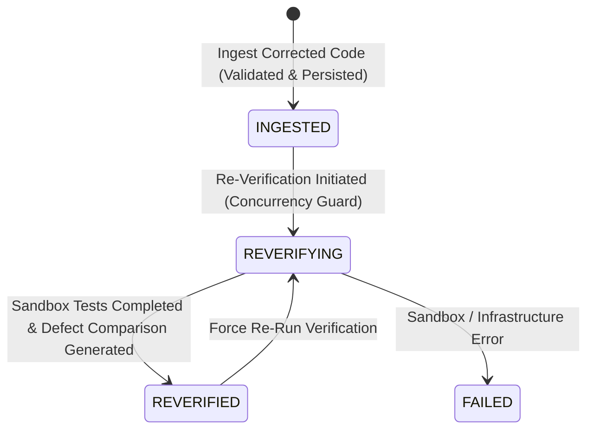

# INTELISE Component 4 — Repair Ingestion, Re-Verification & Defect Resolution Tracking

> **Architecture Status:** Local Repair & Re-Verification Workflow  
> **Milestone:** Phase 4 Milestone 3  
> **Outbound Component 3 Status:** `COMPONENT_3_ENABLED=false` (Local repair testing active; live external dispatch remains disabled).

---

## 1. Overview & Scope

Phase 4 Milestone 3 introduces a secure, closed-loop local repair response ingestion, re-verification, and deterministic defect resolution comparison capability in INTELISE Component 4.

### Key Boundary Disclaimers:
- **Local Workflow Only:** This implementation provides a controlled, internal mechanism to ingest corrected Python source artifacts, re-verify them through the isolated Docker pytest sandbox, and compare empirical defect outcomes against original failed runs.
- **No Component 3 Assumption:** This contract is internal to Component 4. It does **not** assume, simulate, or invent the final API contract of Component 3 (Code Generation/Correction Component).
- **Safe Isolation:** Outbound live dispatch remains safely gated (`COMPONENT_3_ENABLED=false`). Untrusted code is never executed on the FastAPI host.

---

## 2. Local Repair Response Contract

The local repair response schema (`RepairResponseIngestRequest`, `RepairAttempt`, `RepairAttemptResponse`) defines the provisional contract for ingesting and tracking repairs.

### Ingestion Request Schema (`RepairResponseIngestRequest`):
```json
{
  "corrected_code": "def calculate_total(subtotal: float, tax_rate: float) -> float:\n    return round(subtotal * (1 + tax_rate), 2)\n",
  "filename": "billing.py",
  "repair_source": "LOCAL_MANUAL",
  "feedback_iteration_id": "iter-efbb1924c93f",
  "correlation_id": "corr-uuid-optional",
  "external_job_id": null,
  "notes": "Fixed formula to include 1 + tax_rate and round results."
}
```

### Validated Relationships:
1. **Target Verification Run:** Must exist, must be in `FAILED` or `ERROR` state, or possess recorded application defect reports.
2. **Feedback Iteration:** Must exist on the targeted run and must have `approval_status == "APPROVED"`.
3. **Preservation of Original Submission:** The original submission is immutable and remains untouched. A new versioned submission (`CodeSubmissionResponse`) is created for the corrected source code.

---

## 3. Secure Corrected Code Ingestion

Untrusted Python source code submitted as a repair is subjected to defense-in-depth protections:

| Security Control | Validation Mechanism | Threat Mitigated |
|---|---|---|
| **Path Traversal Defense** | Rejects `..`, `/`, `\\`, and drive letters | Host filesystem escape / arbitrary file overwrite |
| **Extension Whitelist** | Enforces `.py` file extension strictly | Arbitrary file type upload / executable polyglots |
| **Payload Integrity** | Validates UTF-8 encoding, non-empty content, size <= 100 KB | Denial-of-Service / Memory exhaustion |
| **Static Syntax Checking** | Statically parsed on backend host using Python's `ast.parse` | Early detection of syntax errors without executing code |
| **Sandbox Isolation** | Execution exclusively in ephemeral Docker containers (`python:3.12-slim`) | Remote Code Execution (RCE) on backend host |
| **Path Masking** | System and container paths are stripped from API responses | Host filesystem information disclosure |

---

## 4. Repair Attempt Lifecycle

A repair attempt transitions through distinct, deterministic states:



- **`INGESTED`**: Corrected code stored in repository as a separate submission, linked to original run and approved feedback iteration.
- **`REVERIFYING`**: Active Docker execution in progress. Concurrency guards prevent duplicate execution triggers.
- **`REVERIFIED`**: Pytest execution completed. Defect resolution comparison generated against original verification evidence.
- **`FAILED`**: Test runner encountered an unrecoverable container or runner error.

---

## 5. Re-Verification Execution Architecture

Re-verification reuses Component 4's existing verification infrastructure:
1. **Artifact Association:** Uses the new submission containing corrected code while reusing the authorized test suite from the original submission.
2. **LangGraph Pipeline:** Orchestrates the verification graph with the new `run_id`.
3. **Docker Isolated Runner:** Executes pytest inside a temporary container with strict CPU/memory limits and network isolation.
4. **Defect Analysis Agent:** Analyzes any remaining test failures to generate updated defect reports.

---

## 6. Deterministic Defect Resolution Comparison

Defect resolution compares actual empirical test execution results between the original verification run and the corrected verification run:

### Comparison Rules:
1. **`RESOLVED`**: A test case that failed or had a defect in the original run now demonstrably **passes** in the corrected run.
2. **`STILL_FAILING`**: A test case that failed in the original run continues to fail in the corrected run.
3. **`NEW_FAILURE`**: A test case that previously passed (or was absent) now fails in the corrected run (regression).
4. **`INCONCLUSIVE`**: A test case that was present in the original run was not executed or errored out due to runner infrastructure issues.

### Overall Resolution Verdicts:
- **`FULLY_RESOLVED`**: All original failures resolved (100% resolution rate), zero regressions, zero still failing.
- **`PARTIALLY_RESOLVED`**: Some original failures resolved, but at least one original failure remains failing.
- **`UNRESOLVED`**: No original failures resolved.
- **`REGRESSION_INTRODUCED`**: Any newly introduced test failure occurs, regardless of other resolutions.
- **`INCONCLUSIVE`**: Test count mismatch, infrastructure error, or incomplete test execution.

---

## 7. Persistence Model & Idempotency

### MongoDB Collection: `repair_attempts`
The collection stores all repair attempts with full relational integrity and comparison history:
```javascript
{
  "_id": "rep-7f8a9b1c2d3e",
  "original_run_id": "run-475a39076d8e",
  "original_submission_id": "sub-01057496e861",
  "feedback_iteration_id": "iter-efbb1924c93f",
  "corrected_submission_id": "sub-882194a2b1c4",
  "corrected_run_id": "run-e3f4a1b2c3d4",
  "repair_source": "LOCAL_MANUAL",
  "status": "REVERIFIED",
  "comparison": {
    "original_run_id": "run-475a39076d8e",
    "corrected_run_id": "run-e3f4a1b2c3d4",
    "verdict": "FULLY_RESOLVED",
    "original_defects_count": 2,
    "resolved_defects_count": 2,
    "remaining_defects_count": 0,
    "new_defects_count": 0,
    "resolution_rate": 100.0,
    "test_comparisons": [...]
  },
  "created_at": ISODate("2026-10-15T12:00:00Z"),
  "updated_at": ISODate("2026-10-15T12:02:30Z")
}
```

### Idempotency Protections:
- Submitting identical corrected code for the same approved feedback iteration returns the existing `RepairAttempt` rather than spawning duplicate records.
- Re-verifying an already completed repair returns the existing outcome unless `force=true` is explicitly requested.
- In-flight runs are guarded by the `REVERIFYING` atomic state lock.

---

## 8. API Endpoints

All new endpoints reside under the `/api/v1/verifications/{run_id}` namespace:

| Method | Path | Description |
|---|---|---|
| `POST` | `/api/v1/verifications/{run_id}/repair-responses` | Ingests corrected Python source code (201 Created) |
| `POST` | `/api/v1/verifications/{run_id}/repair-responses/{repair_id}/re-verify` | Triggers Docker-isolated re-verification and comparison |
| `GET` | `/api/v1/verifications/{run_id}/repair-responses` | Lists all repair attempts recorded for the run |
| `GET` | `/api/v1/verifications/{run_id}/repair-responses/{repair_id}` | Retrieves full repair attempt details |
| `GET` | `/api/v1/verifications/{run_id}/repair-responses/{repair_id}/comparison` | Retrieves defect resolution comparison verdict and table |

---

## 9. Step-by-Step Manual Testing Instructions

### Prerequisites:
1. Start the backend:
   ```bash
   cd component-4/backend
   ..\.venv\Scripts\uvicorn app.main:app --port 8000 --reload
   ```
2. Start the frontend:
   ```bash
   cd component-4/frontend
   npm run dev
   ```

### Verification Flow:
1. Navigate to **Verification Pipelines** (`http://localhost:5173/runs`).
2. Select the existing failed run `run-475a39076d8e` and click **Details**.
3. Confirm that the run has approved feedback iteration `iter-efbb1924c93f`.
4. In the **Repair Ingestion & Re-Verification** section, click **Submit Corrected Code**.
5. Paste a corrected implementation of the tax calculation:
   ```python
   def calculate_total(subtotal: float, tax_rate: float) -> float:
       return round(subtotal * (1.0 + tax_rate), 2)
   ```
6. Click **Ingest Corrected Code**.
7. Confirm that the repair attempt is created in `INGESTED` state.
8. Click **Re-Verify Solution**.
9. Observe the Docker sandbox execution and the resulting defect comparison card:
   - Verdict: **All Defects Resolved** (`FULLY_RESOLVED`)
   - Resolution Rate: **100%**
   - Both `test_total_with_tax` and `test_total_without_tax` show `RESOLVED` status with green checkmarks.
