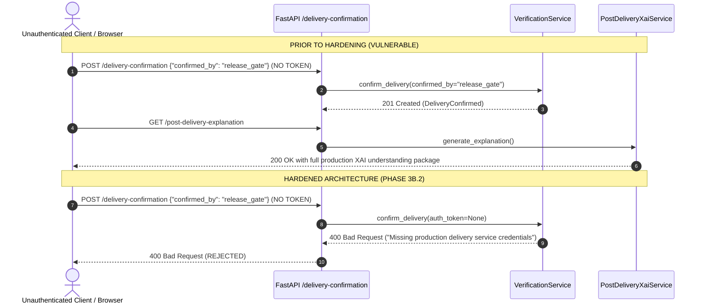

# INTELISE Component 4 — Phase 3B.2: Post-Delivery XAI Security Hardening & Trusted Delivery Authorization

**Document Reference:** `docs/PHASE3B2_XAI_SECURITY_HARDENING.md`  
**Evaluation Phase:** Phase 3B.2 Security Hardening & Access Control  
**Security Scope:** Production Delivery Confirmation & Post-Delivery Code Understanding Gate  
**Date:** October 2026  
**Status:** VERIFIED & HARDENED (All 17 Security Tests Passing)  

---

## 1. Executive Summary

This report documents the security audit and server-side authorization hardening of the Post-Delivery Explainable AI (XAI) subsystem in INTELISE Component 4 (*Intelligent Agentic Testing & Explainable Feedback Loop Assistant*). 

The supervisor-approved architectural role of Post-Delivery XAI is to explain software understanding to end users **exclusively after the software has passed all verification gates, satisfied deployment governance, and been legitimately delivered into production**.

Prior to Phase 3B.2, an authorization vulnerability existed where unauthenticated clients could forge delivery credentials using caller-supplied role strings or simulation flags, prematurely unlocking production code explanations. This audit eliminates that vulnerability by implementing backend-verified service credentials, constant-time comparison, server-derived identity, strict simulation isolation, and re-verification invalidation.

---

## 2. Vulnerability Audit & Attack Path Documentation

### 2.1 Confirmed Vulnerability: Caller-Supplied Identity & Simulation Bypass

Prior to this hardening phase:
1. **Unauthenticated Delivery Confirmation**: The `POST /api/v1/verifications/{run_id}/delivery-confirmation` endpoint accepted a JSON payload containing `confirmed_by: Optional[str] = "delivery_orchestrator"`. Any unauthenticated network client could forge this value (e.g., submitting `{"confirmed_by": "ci_cd_deployment"}` or `{"confirmed_by": "release_gate"}`). The backend accepted this string at face value without validating cryptographic identity or service tokens.
2. **Simulation Leakage into Production Gate**: Clients could submit `{"is_simulation": true}`, which recorded a delivery confirmation that subsequent XAI endpoints treated as sufficient to unlock full production code explanations.
3. **No Replay or Re-Verification Invalidation**: A delivery confirmation created for one verification run could persist even if the run was subsequently re-executed and failed tests.

### 2.2 Attack Path Scenario



---

## 3. Trusted Production Delivery Architecture

### 3.1 Authentication & Authorization Design

The hardened architecture derives authorization strictly from server-side verified credentials:

1. **Service Authentication Headers**:
   Production delivery calls must present legitimate service credentials via either:
   - `X-Delivery-Token: <token>`
   - `Authorization: Bearer <token>`
2. **Constant-Time Secret Comparison**:
   Tokens are validated against `settings.DELIVERY_AUTH_TOKEN` using `secrets.compare_digest` to prevent timing attacks.
3. **Server-Assigned Identity**:
   Caller-supplied role strings (`confirmed_by: "..."`) are **discarded**. The server unconditionally sets:
   - Production delivery: `confirmed_by = "authenticated_delivery_service"`
   - Simulation mode: `confirmed_by = "simulated_harness"`
4. **Artifact Version & SHA-256 Manifest Lock**:
   Production delivery requires `artifact_version` matching the verified `run.submission_id`. The server computes SHA-256 over `submission.code` at confirmation time and verifies it matches at explanation generation time (`BLOCKED_HASH_MISMATCH` if tampered).
5. **Re-Verification Invalidation**:
   When `POST /api/v1/verifications/{run_id}/execute` is triggered to re-verify code, `run.delivery_confirmation` is set to `None`, returning the delivery gate to `PENDING_DELIVERY_CONFIRMATION`.
6. **Replay Rejection**:
   If a confirmation record from run $A$ is injected into run $B$, `delivery.verification_run_id != run.id` is caught, issuing verdict `BLOCKED_UNAUTHORIZED_DELIVERY`.
7. **Secret Redaction**:
   Neither `DELIVERY_AUTH_TOKEN` nor any token fragments are logged or exposed in HTTP response payloads.

---

### 3.2 Simulation vs. Production Strict Separation

| Dimension | Simulated Delivery (`is_simulation: True`) | Production Delivery (`is_simulation: False`) |
| :--- | :--- | :--- |
| **Intended Environment** | Development / Test Harness only (`ENVIRONMENT != "production"`) | Staging / Production release pipeline |
| **Credential Required** | None (guarded by backend environment check) | `X-Delivery-Token` or `Bearer` token |
| **Environment Guard** | Blocked if `ALLOW_SIMULATED_DELIVERY=False` or `ENVIRONMENT="production"` | Always enforced |
| **Confirmed Entity** | `simulated_harness` (server-assigned) | `authenticated_delivery_service` (server-assigned) |
| **Delivery Gate Verdict** | `SIMULATED_DELIVERY` | `CONFIRMED_PRODUCTION_DELIVERY` |
| **General XAI Route (`/explanation`)** | `eligible = False`, `post_delivery_explanation = None` | `eligible = True`, `post_delivery_explanation = Object` |
| **Dedicated Route (`/post-delivery-explanation`)** | **HTTP 400 Rejected** (simulation cannot satisfy gate) | **HTTP 200 OK** (unlocked) |
| **Frontend UI Presentation** | Visible Warning Badge: `SIMULATED DELIVERY (DEV MODE)` | Verified Badge: `CONFIRMED PRODUCTION DELIVERY` |

---

## 4. Summary of Code Changes

### 4.1 Configuration (`backend/app/core/config.py`)
- Added `DELIVERY_AUTH_TOKEN: str = "intelise_dev_delivery_token_secret"`.
- Added `ALLOW_SIMULATED_DELIVERY: bool = True`.
- Added `is_simulation_permitted() -> bool`:
  ```python
  def is_simulation_permitted(self) -> bool:
      if self.ENVIRONMENT.lower() == "production":
          return False
      return self.ALLOW_SIMULATED_DELIVERY
  ```

### 4.2 API Endpoint (`backend/app/api/v1/verifications.py`)
- Updated `POST /api/v1/verifications/{run_id}/delivery-confirmation` to extract:
  - Header `X-Delivery-Token`
  - Header `Authorization` (Bearer scheme)
- Passes extracted `auth_token` to `VerificationService.confirm_delivery`.

### 4.3 Service Implementation (`backend/app/services/verification_service.py`)
- **Version Integrity Check**: Rejects any mismatched `artifact_version` before branching.
- **Simulation Enforcement**: Checks `settings.is_simulation_permitted()`.
- **Credential Validation**: Validates `secrets.compare_digest(auth_token.strip(), expected_token.strip())`.
- **Identity Derivation**: Sets `confirmed_by = "authenticated_delivery_service"`.
- **Re-Verification Reset**: Sets `run.delivery_confirmation = None` in `execute_verification_run`.
- **Endpoint Guard**: In `get_post_delivery_explanation`, raises `InvalidInputException` if `is_simulation is True`.

### 4.4 Gate Evaluator (`backend/app/services/post_delivery_xai_service.py`)
- Updated `evaluate_delivery_gate`:
  - `delivery.verification_run_id != run.id` $\implies$ `BLOCKED_UNAUTHORIZED_DELIVERY`.
  - Checksum mismatch $\implies$ `BLOCKED_HASH_MISMATCH`.
  - Submission version mismatch $\implies$ `BLOCKED_VERSION_MISMATCH`.
  - Simulation in production environment $\implies$ `BLOCKED_UNAUTHORIZED_DELIVERY`.
  - Simulation in dev environment $\implies$ `SIMULATED_DELIVERY`.
  - Authenticated production delivery $\implies$ `CONFIRMED_PRODUCTION_DELIVERY`.
- Implemented `_build_simulated_response` returning `eligible=False` and `post_delivery_explanation=None`.

### 4.5 Frontend UI (`frontend/src/pages/XaiExplanationsPage.jsx`)
- Added clear delivery badges: `SIMULATED DELIVERY (DEV MODE)`, `CONFIRMED PRODUCTION DELIVERY`, and `BLOCKED_*`.
- Added warning banner when simulated delivery is active, notifying the user that simulation enables dev telemetry preview but does not unlock production code understanding.

---

## 5. Security Test Suite Verification (17 Requirements)

Automated tests in `backend/tests/test_post_delivery_xai.py` verify all 17 security requirements:

| # | Security Requirement | Test Function | Result |
| :---: | :--- | :--- | :---: |
| 1 | Missing production credentials rejected | `test_security_01_missing_production_credentials` | **PASSED** |
| 2 | Invalid credentials rejected | `test_security_02_invalid_credentials` | **PASSED** |
| 3 | Valid authenticated service identity accepted | `test_security_03_valid_authenticated_service_identity` | **PASSED** |
| 4 | Caller-supplied forged role strings overridden | `test_security_04_caller_supplied_forged_role_strings` | **PASSED** |
| 5 | Unauthorized frontend production confirmation rejected | `test_security_05_unauthorized_frontend_production_confirmation` | **PASSED** |
| 6 | Simulation attempts in production mode rejected | `test_security_06_simulation_attempts_in_production_mode` | **PASSED** |
| 7 | Valid simulation in explicitly enabled dev mode | `test_security_07_valid_simulation_in_explicitly_enabled_development_mode` | **PASSED** |
| 8 | Simulated delivery requesting production-gated XAI rejected | `test_security_08_simulated_delivery_requesting_production_gated_explanations` | **PASSED** |
| 9 | Artifact checksum mismatch detected and blocked | `test_security_09_artifact_checksum_mismatch` | **PASSED** |
| 10 | Artifact version mismatch detected and blocked | `test_security_10_artifact_version_mismatch` | **PASSED** |
| 11 | Re-verification invalidates prior delivery confirmation | `test_security_11_reverification_invalidates_delivery_confirmation` | **PASSED** |
| 12 | Confirmation replay across different runs rejected | `test_security_12_confirmation_replay_across_different_runs` | **PASSED** |
| 13 | Verification failure rejects delivery confirmation | `test_security_13_verification_failure_rejects_delivery` | **PASSED** |
| 14 | Governance rejection blocks delivery confirmation | `test_security_14_governance_rejection_blocks_delivery` | **PASSED** |
| 15 | Successful authorized production confirmation unlocks XAI | `test_security_15_successful_authorized_production_confirmation` | **PASSED** |
| 16 | Secret token redacted from logs and API responses | `test_security_16_secret_redaction_in_logs_and_api_responses` | **PASSED** |
| 17 | Legacy explanation endpoint bypass attempts rejected | `test_security_17_legacy_explanation_endpoint_bypass_attempts` | **PASSED** |

```
tests\test_post_delivery_xai.py ...........................              [100%]
============================= 27 passed in 47.80s =============================
```

---

## 6. Environment Configuration Requirements

To run Component 4 in production mode with secure delivery confirmation:

```bash
# Production environment configuration (.env)
ENVIRONMENT=production
DEBUG=false
ALLOW_SIMULATED_DELIVERY=false

# Generate high-entropy delivery token (e.g., openssl rand -hex 32)
DELIVERY_AUTH_TOKEN=c3f7b2e98124976d8b941097fa620e447b9df87b92110c73eef0768b5a034299
```

> **Security Warning**: When `ENVIRONMENT=production`, the application strictly prohibits using the development fallback token `"intelise_dev_delivery_token_secret"`. Any attempt to confirm delivery with the default secret in production raises an immediate configuration exception.

---

## 7. Remaining Security Limitations & Research Disclosures

1. **Prototype Credential Mechanism**: The current prototype uses a shared pre-shared secret (service token). In an enterprise multi-tenant deployment, this should be superseded by an asymmetric mTLS certificate or JWT signed by a dedicated OpenID Connect identity provider.
2. **Component 3 Direct Integration**: As specified in university project constraints, `COMPONENT_3_ENABLED=false` is maintained. Delivery confirmations are simulated by external API clients or test harnesses; live CI/CD runner integration is simulated.
3. **Storage At-Rest Encryption**: In MongoDB production mode, delivery confirmation tokens and audit hashes rely on MongoDB database access controls and TLS in transit. Transparent database encryption at rest should be enabled in production clusters.
