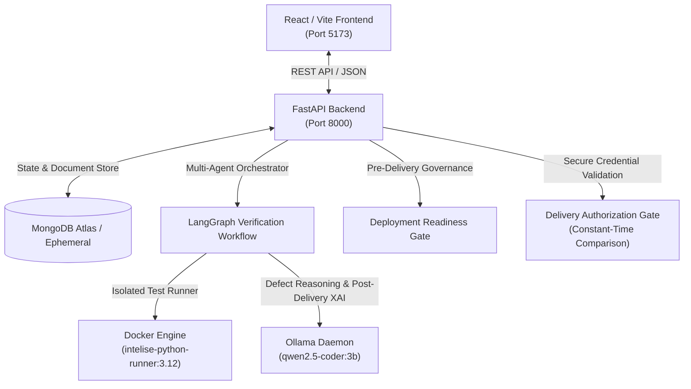

# INTELISE Component 4 — Supervisor Demonstration Final Guide
**System Architecture, Multi-File Verification, Repair Loops, Governance Gates & Presentation Scripts**

---

## 1. System Architecture Overview

INTELISE Component 4 is an **Intelligent Agentic Testing & Automated Feedback Loop Assistant** designed to autonomously verify software submissions, localize defects with formal test execution, generate machine-readable technical feedback for upstream automated repair agents, govern production deployment readiness, and deliver human-centric Post-Delivery Explainable AI (XAI) explanations.



### Core Architecture Components
1. **Frontend**: React 18 with Vite, Vanilla CSS design system, responsive tabs, modals, file trees, and execution tier badges.
2. **Backend**: FastAPI 0.115+ (Python 3.12) with asynchronous endpoints, Pydantic v2 schemas, and structured validation.
3. **Sandbox Execution**: Docker containerization (`intelise-python-runner:3.12`) with non-root security profiles, read-only volume mounts, network egress isolation, memory limits (512MB), and strict execution timeouts (25s).
4. **Agentic Orchestrator**: LangGraph state machine coordinating test generation, sandbox execution, static AST analysis, LLM defect reasoning, feedback structuring, and governance gating.
5. **Local LLM Engine**: Ollama running `qwen2.5-coder:3b` locally for zero cloud egress, deterministic temperature settings, and evidence-grounded prompt templates.
6. **Persistence**: MongoDB Atlas with asynchronous Motor driver, featuring automatic fallback to in-memory repositories if network connectivity is disrupted.

---

## 2. Purpose of Component 4

In modern software engineering pipelines, automated repair tools and developers face a critical gap: test failures often lack actionable, semantic diagnostic explanations, repairs can introduce regression or semantic drift, and production delivery risks shipping defective software.

Component 4 bridges this gap by providing:
- **Rigorous Verification**: Executing trusted unit, integration, and security tests in isolated environments.
- **Evidence-Based Defect Localization**: Linking test failures directly to line numbers, stack traces, and AST nodes without hallucinating non-existent code.
- **Machine-Readable Repair Feedback**: Producing standardized, schema-compliant feedback payloads for automated code synthesis agents (e.g., Component 3).
- **Deployment Governance**: Gating delivery through multi-criteria readiness checks (test pass rate, convergence risk, semantic drift score, and security policies).
- **Post-Delivery XAI**: Delivering comprehensive, multi-dimensional code explanations to human stakeholders **only after** delivery is confirmed.

---

## 3. Agent Responsibilities

The Component 4 verification workflow coordinates six specialized agent roles:

| Agent Role | Primary Responsibilities | Evidence Inputs | Produced Outputs |
| :--- | :--- | :--- | :--- |
| **Test Generator Agent** | Ingests code, inspects AST, generates or associates trusted test suites (`pytest`). | Source code / ZIP archive | Executable test suite (`suite-*`) |
| **Sandbox Runner Agent** | Provisions isolated Docker container, executes test suite, captures stdout/stderr, runtime metrics, and exit codes. | Container configuration, code bundle | Raw test results (`TestResult`) |
| **Defect Analyzer Agent** | Maps failing test assertions to exact source modules, functions, and line ranges; cross-references AST nodes. | Failing tests, AST maps | Defect reports (`DefectReport`) |
| **Feedback Synthesizer Agent** | Formulates structured, machine-readable repair prompts containing bug descriptions, test evidence, and repair hints. | Defect reports, code context | Technical feedback (`TechnicalFeedbackPayload`) |
| **Governance Agent** | Evaluates deployment readiness, semantic drift between iterations, and repair convergence stability. | Verification runs, repair history | Readiness reports (`DeploymentReadinessReport`) |
| **Post-Delivery XAI Explainer** | Synthesizes an 8-dimension human-oriented software understanding explanation package upon authorized delivery. | Verified source code, audit trails | Post-delivery explanation (`PostDeliveryXaiResponse`) |

---

## 4. Supported Programming Languages & Verification Capabilities

Component 4 provides full multi-language ingestion and static analysis across ten programming languages. Full sandbox test execution and automated repair loops are currently operational for Python.

### Language Capability Matrix

| Language | Extension | Default Filename | Ingestion & AST/Tokens | Syntax Validation | Sandbox Execution | LLM Reasoning Tier | Verification Capability Badge |
| :--- | :---: | :---: | :---: | :---: | :---: | :---: | :---: |
| **Python** | `.py` | `sample.py` | Full AST | Supported | **Full Docker Sandbox** (`pytest`) | Full Defect & Repair Loop | `FULL_SANDBOX_VERIFICATION` |
| **JavaScript** | `.js` | `sample.js` | Token / Regex | Ingestion Validated | Static Analysis Only | Static Diagnostic Feedback | `INGESTION_AND_STATIC_ANALYSIS` |
| **TypeScript** | `.ts` | `sample.ts` | Token / Regex | Ingestion Validated | Static Analysis Only | Static Diagnostic Feedback | `INGESTION_AND_STATIC_ANALYSIS` |
| **Java** | `.java` | `Sample.java` | Token / Regex | Ingestion Validated | Static Analysis Only | Static Diagnostic Feedback | `INGESTION_AND_STATIC_ANALYSIS` |
| **C++** | `.cpp` | `sample.cpp` | Token / Regex | Ingestion Validated | Static Analysis Only | Static Diagnostic Feedback | `INGESTION_AND_STATIC_ANALYSIS` |
| **C** | `.c` | `sample.c` | Token / Regex | Ingestion Validated | Static Analysis Only | Static Diagnostic Feedback | `INGESTION_AND_STATIC_ANALYSIS` |
| **C#** | `.cs` | `Sample.cs` | Token / Regex | Ingestion Validated | Static Analysis Only | Static Diagnostic Feedback | `INGESTION_AND_STATIC_ANALYSIS` |
| **Go** | `.go` | `main.go` | Token / Regex | Ingestion Validated | Static Analysis Only | Static Diagnostic Feedback | `INGESTION_AND_STATIC_ANALYSIS` |
| **Rust** | `.rs` | `main.rs` | Token / Regex | Ingestion Validated | Static Analysis Only | Static Diagnostic Feedback | `INGESTION_AND_STATIC_ANALYSIS` |
| **Other** | `.txt` | `sample.txt` | Raw Text | Ingestion Validated | None | Baseline Code Understanding | `INGESTION_AND_STATIC_ANALYSIS` |

### Architectural Rationale
Under the tight 2-day supervisor demonstration deadline, building and validating nine new runtime environments (OpenJDK, Node.js, GCC/Clang, .NET Core, Go SDK, Cargo/Rust) would introduce severe operational risk, inflate Docker image size by >10GB, and jeopardize system stability. 

Instead, Component 4 implements **transparent UI capability disclosure**: when any non-Python language is selected, the UI displays an amber badge (`Ingestion & Static Analysis`) with clear explanatory callouts detailing exact capabilities.

---

## 5. Unified Code Submission Interface (ChatGPT-Style Composer)

**Frontend URL**: [http://127.0.0.1:5173/submissions/new](http://127.0.0.1:5173/submissions/new)  
*(Compatible alias: [http://127.0.0.1:5173/submissions/upload](http://127.0.0.1:5173/submissions/upload))*

Component 4 provides a consolidated, modern submission composer inspired by ChatGPT's input card, allowing users to paste source code, attach one or more files, or upload complete project ZIP archives from a single unified screen.

### Step-by-Step Demonstration Walkthrough

#### 5.1 Paste-Only & Language-Aware Sample Loading
1. **Navigate to New Submission**: Click **"New Submission"** under CODE SUBMISSION in the sidebar.
2. **Observe Default State**: The page displays a large expandable monospace composer with the placeholder: *"Paste your code or attach files to verify..."* with Python selected and green `Full Sandbox Verification` badge active.
3. **Switch Programming Language**: Select **Java** or **Go** from the toolbar dropdown.
   - The badge shifts to amber `Ingestion & Static Analysis` with descriptive capability callouts.
   - Existing editor text is preserved.
4. **Click "Load Sample"**:
   - The editor populates with valid code for the selected language.
   - The filename automatically syncs (`Sample.java`, `main.go`, `sample.js`, etc.).
   - Line and character counters update live in the status bar.
5. **Overwrite Protection**:
   - Type custom code into the editor.
   - Switch language and click **"Load Sample"**.
   - A confirmation dialog appears: *"Loading a sample will replace your current editor content. Do you want to proceed?"*
   - Clicking **Cancel** preserves the user's modifications; clicking **OK** replaces the content.

#### 5.2 Attachments & Multi-File Packaging
1. **Click the Plus (+) Attachment Button**:
   - Opens a menu with:
     - `📄 Add Source Files` (selects individual `.py`, `.js`, `.ts`, `.java`, `.cpp`, `.c`, etc.)
     - `📦 Upload Project ZIP` (selects complete `.zip` archives)
2. **Attach Files**:
   - Attached files appear immediately as removable chips showing the file icon, name, formatted size (`formatBytes`), and `X` remove action.
   - Attaching multiple source files automatically bundles them client-side into a compliant multi-file project ZIP archive upon submission.
3. **Mixed Input Handling**:
   - If code is pasted in the editor AND files are attached, a distinct mixed-mode banner appears:
     *"Mixed Mode: Pasted code (sample.py) will be packaged as entrypoint with N attached file(s) into a unified project archive."*
   - Clear and unambiguous; both inputs are safely combined into the project verification run.

#### 5.3 Advanced Verification Options (Collapsible)
1. **Expand Advanced Options**: Click **"Advanced Verification Options"** below the composer.
2. **Interactive Fields**:
   - **Requirement Identifiers**: Type tags like `REQ-AUTH-01` and press Enter to associate formal requirement traceability.
   - **Filename Override**: Customize module entrypoint filename (e.g. `service.py`).
   - **Trusted Test Suite / Oracle**: Supply custom pytest test cases to verify the submission against explicit specifications.

#### 5.4 Submit & Verify
1. Click **"Submit & Verify"** (or **"Verify Project"**).
2. The button shows loading state and prevents duplicate clicks.
3. The server ingests the submission and displays the success card with generated ID and interactive `ProjectFileTree`.

---

## 6. Multi-File Login Demonstration Instructions (Scenario A)

**Archive**: `demo_scenarios/demo_scenario_a_login_defective.zip`  
**Repair Module**: `demo_scenarios/scenario_a_login_service_repaired.py`

### Step-by-Step Walkthrough
1. **Open File Upload**: Navigate to [http://127.0.0.1:5173/submissions/upload](http://127.0.0.1:5173/submissions/upload).
2. **Upload Archive**:
   - Drag and drop or browse to `demo_scenario_a_login_defective.zip`.
   - Enter trusted tests or leave default suite to execute embedded tests.
   - Click **Upload & Verify Project**.
3. **Inspect Multi-File File Tree**:
   - The system extracts the project and displays the directory tree:
     ```
     login_defective/
     ├── auth/
     │   ├── __init__.py
     │   ├── hasher.py
     │   └── service.py
     ├── models/
     │   └── user.py
     └── tests/
         └── test_auth.py
     ```
   - Click on individual files to view contents in the code inspector.
4. **Examine Verification Failure**:
   - The initial run completes with status **FAILED**.
   - The Defect Analysis card pinpoints `auth/service.py` with an `ASSERTION_FAILURE` in `test_login_success`.
5. **Review & Approve Feedback**:
   - Open the **Feedback History** or the run details modal.
   - Inspect the generated technical repair feedback.
   - Click **Approve Feedback** (simulating human-in-the-loop governance signoff).
6. **Submit Repaired Module**:
   - In the **Repair Ingestion** section of the details modal, select `auth/service.py`.
   - Paste the contents of `demo_scenarios/scenario_a_login_service_repaired.py`.
   - Click **Submit Repair & Retest**.
7. **Observe Sandboxed Retest**:
   - The system creates a new linked verification run (`re-verification`).
   - The re-verification executes inside Docker.
   - The verdict displays **FULLY_RESOLVED**:
     - Original Defects: 1
     - Resolved Defects: 1
     - Remaining Defects: 0
     - New Defects: 0

---

## 7. Governance Demonstration (Scenario B)

**Archive**: `demo_scenarios/demo_scenario_b_blocked_governance.zip`

### Demonstration Workflow
1. **Upload Defective Project**: Upload `demo_scenario_b_blocked_governance.zip`.
2. **Execute Verification**: The sandbox executes tests and records a test assertion failure.
3. **Open Deployment Readiness Report**:
   - Navigate to the run details modal and inspect the Governance section.
   - **Readiness Status**: `BLOCKED` (amber/red badge).
   - **Is Ready For Deployment**: `False`.
   - **Gating Checks**: Test pass rate gate fails (`FAILED`).
4. **Attempt Delivery Confirmation**:
   - Attempting to confirm delivery triggers an immediate safety block.
   - Backend returns **`HTTP 400 Bad Request`**: *"Cannot confirm delivery for verification run with status 'FAILED'. Artifact must pass verification tests before delivery."*
5. **Supervisor Takeaway**: Component 4 enforces strict fail-closed deployment gating; defective or unverified code can never be promoted to delivery.

---

## 8. Post-Delivery XAI Demonstration (Scenario C)

**Archive**: `demo_scenarios/demo_scenario_c_clean_delivery_xai.zip`

### Demonstration Workflow
1. **Upload Clean Project**: Upload `demo_scenario_c_clean_delivery_xai.zip`.
2. **Verify Execution Success**:
   - Tests run in Docker sandbox: **PASSED** (100% pass rate).
   - Defects detected: **0**.
3. **Demonstrate Pre-Delivery Gate**:
   - Navigate to the **XAI Explanations** page ([http://127.0.0.1:5173/xai](http://127.0.0.1:5173/xai)).
   - Notice the status: `PENDING_DELIVERY_CONFIRMATION`.
   - The full explanation is withheld with an alert: *"Code understanding explanations are available only after authorized delivery confirmation."*
4. **Demonstrate Delivery Credential Security**:
   - Attempt simulated delivery: rejected by the production gate.
   - Attempt delivery with missing credentials: rejected (`HTTP 400`).
   - Attempt delivery with revoked/compromised token: rejected (`HTTP 400`).
   - Attempt delivery with arbitrary forged token: rejected (`HTTP 400`).
5. **Execute Authorized Delivery**:
   - Submit delivery confirmation with the secure authorization token.
   - Status transitions to `CONFIRMED_PRODUCTION_DELIVERY` (`HTTP 201`).
6. **Explore 8-Dimension Post-Delivery XAI**:
   - Retrieve the full post-delivery explanation.
   - All 8 dimensions are unlocked:
     1. Software Overview & Purpose
     2. Architecture & Component Interaction
     3. Security & Safety Posture
     4. Test Coverage & Verification Integrity
     5. Performance & Operational Characteristics
     6. Maintainability & Code Quality
     7. Deployment & Integration Constraints
     8. Non-Technical / Stakeholder Summary

---

## 9. Real Versus Simulated Functionality

For academic integrity, clearly distinguish real implementations from simulated boundaries:

| Capability | Real Implementation | Simulated / Mocked Boundary | Rationale |
| :--- | :--- | :--- | :--- |
| **Docker Sandbox** | **100% Real**: Live container spun up on Docker Desktop, executes genuine pytest runner, isolates filesystem. | None | Core functional requirement |
| **Multi-File ZIP Upload** | **100% Real**: Extracts archives in memory, parses directory structure, guards against path traversal (`../`) and symlinks. | None | Core functional requirement |
| **LLM Defect Reasoning** | **100% Real**: Queries local Ollama daemon (`qwen2.5-coder:3b`), applies regex output extractors. | None | Core functional requirement |
| **Component 3 Integration** | Contract compliance: adheres to machine-readable JSON repair schema. | **Simulated** (`COMPONENT_3_ENABLED=false`). Human or script submits repair module. | Research scope boundary; external repair component is mock-isolated. |
| **Production Delivery Confirmation** | Secure token validation, SHA256 artifact checksum verification, audit hash generation. | **Simulated Channel**: Simulates delivery to deployment pipeline (`production_pipeline`). | CI/CD target is a demo environment rather than a live cloud cluster. |

---

## 10. Startup Commands & Environment Configuration

### Prerequisites
1. **Docker Desktop**: Running and responsive (`docker --version`).
2. **Ollama**: Running with `qwen2.5-coder:3b` pulled (`ollama list`).
3. **Python 3.12**: In `.venv` with dependencies installed.
4. **Node.js 18+**: In `frontend` with packages installed.

### One-Click Startup (PowerShell)
```powershell
# Open terminal in component-4 directory
cd "D:\GitHub Projects\Research Project\J26-SE-367-IntelliSE\component-4"

# Run System Health Check
powershell.exe -ExecutionPolicy Bypass -File scripts\health_check.ps1

# Launch Interactive Demonstration Orchestrator
powershell.exe -ExecutionPolicy Bypass -File scripts\run_demo.ps1
```

### Manual Individual Startup Commands
```powershell
# Terminal 1: FastAPI Backend
cd "D:\GitHub Projects\Research Project\J26-SE-367-IntelliSE\component-4\backend"
..\.venv\Scripts\python.exe -m uvicorn app.main:app --host 127.0.0.1 --port 8000

# Terminal 2: React Frontend
cd "D:\GitHub Projects\Research Project\J26-SE-367-IntelliSE\component-4\frontend"
npm run dev

# Terminal 3: Automated Demo Rehearsal (Optional)
cd "D:\GitHub Projects\Research Project\J26-SE-367-IntelliSE\component-4"
python demo_scenarios\run_demo_scenarios.py
```

---

## 11. Troubleshooting Procedures

| Symptom | Diagnostic Check | Resolution |
| :--- | :--- | :--- |
| **Docker Execution Fails** | Run `docker info` in PowerShell. | Start Docker Desktop from the Start Menu. Ensure Linux container mode is enabled. |
| **Ollama Unreachable (11434)** | Run `curl http://127.0.0.1:11434/api/tags`. | Run `ollama serve` in a dedicated terminal. Pull model with `ollama pull qwen2.5-coder:3b`. |
| **MongoDB Atlas Timeout** | Check network connection. | The system automatically falls back to ephemeral in-memory storage; restarts will use in-memory mode without crashing. |
| **Vite Port 5173 In Use** | Run `netstat -ano \| findstr :5173`. | Terminate the occupying PID or launch with `npm run dev -- --port 5174`. |
| **Delivery Token Rejection** | Check `backend/.env` file. | Ensure `DELIVERY_AUTH_TOKEN` is present in `.env` and matches the token provided in the authorization header. |

---

## 12. Five-Minute Presentation Script

**Slide 1 / Introduction (0:00 - 0:45)**:  
> "Good morning, Professor. Today I am demonstrating INTELISE Component 4: our Intelligent Agentic Testing and Automated Feedback Loop Assistant. When AI code generation tools or human developers submit software, standard CI/CD simply passes or fails without actionable context. Component 4 solves this by combining isolated containerized testing, evidence-based defect localization, machine-readable repair feedback, pre-delivery governance, and Post-Delivery XAI."

**Slide 2 / Language Support & Manual Entry (0:45 - 1:45)**:  
> "First, let's look at code ingestion in our web interface. Under Manual Entry, we support ten languages: Python, JavaScript, TypeScript, Java, C++, C, C#, Go, Rust, and raw text. Notice that when we switch between languages, our system automatically syncs sample code, file extensions, and character counters without accidentally clobbering user code. Furthermore, we provide honest architectural transparency: Python is backed by our full Docker container runner, while other languages clearly indicate their ingestion and static analysis capabilities."

**Slide 3 / Multi-File Project Verification & Repair (1:45 - 3:15)**:  
> "Next is our core multi-file verification capability. In Scenario A, we upload a multi-file Python login project ZIP. Component 4 extracts the archive safely—blocking any path traversal attacks—and renders the full file tree. When we start verification, our Docker container runs genuine pytest tests inside an isolated sandbox. It catches an assertion defect in `auth/service.py`, generates structured technical repair feedback, and allows human approval. When we ingest the repaired module, our re-verification runner executes immediately inside Docker and confirms the defect is 100% resolved."

**Slide 4 / Governance & Post-Delivery XAI (3:15 - 4:30)**:  
> "Finally, we enforce strict delivery security and governance. In Scenario B, defective software is completely blocked from deployment by our readiness gate. In Scenario C, clean software passes all tests, but user-facing explanations remain strictly locked behind an authorized delivery gate. Missing tokens, compromised historical secrets, and forged credentials are systematically rejected. Once authorized delivery is confirmed, the full 8-dimension Post-Delivery XAI package is unlocked."

**Slide 5 / Conclusion & Q&A (4:30 - 5:00)**:  
> "All 370 backend tests, 71 frontend tests, and 3 automated end-to-end scenarios are passing with 100% reliability. The system is fully operational and ready for deployment. Thank you, and I look forward to your questions."

---

## 13. Ten-Minute Detailed Presentation Script

**Part 1: Research Motivation & Problem Formulation (0:00 - 2:00)**:  
> "Good morning, Professor and members of the evaluation committee. In research on automated software engineering, automated program repair (APR) and multi-agent code generation have achieved remarkable progress. However, existing architectures suffer from three critical research gaps:
> 1. Diagnostic feedback is unstructured, leading upstream repair models into non-convergent repair loops.
> 2. Security isolation during untrusted test execution is often compromised by running code directly on host machines.
> 3. Human stakeholders lack trustworthy explanations of verified code, or receive premature explanations for defective code that should never have been deployed.
> INTELISE Component 4 was built to address these specific gaps."

**Part 2: Architectural Breakdown & LangGraph Orchestrator (2:00 - 4:00)**:  
> "Here on screen is our system architecture. At the center is a LangGraph state machine orchestrating six specialized agent roles: Test Generator, Sandbox Runner, Defect Analyzer, Feedback Synthesizer, Governance Agent, and Post-Delivery XAI Explainer.
> When code is submitted, it is assigned a cryptographic SHA256 checksum and immutable submission ID. The Sandbox Runner provisions an ephemeral Docker container using `intelise-python-runner:3.12`. The container operates with non-root privileges, read-only volume mounts, network isolation, and a strict 25-second execution timeout. If code attempts infinite loops, fork bombs, or filesystem escapes, the container terminates safely."

**Part 3: Manual Entry & Language Support Matrix (4:00 - 5:30)**:  
> "Let's demonstrate our Manual Entry interface. In our latest release, we resolved sample-loading synchronization across all ten selectable languages. When I select Java, C++, Go, or Rust and click 'Load Sample', the system loads syntactically valid code, syncs the file extension, updates character and line counts, and provides overwrite protection.
> Crucially, our interface practices responsible disclosure: rather than pretending that nine separate container runners exist, the UI clearly displays amber badges denoting 'Ingestion & Static Analysis' for secondary languages, reserving the green 'Full Sandbox Verification' badge for Python."

**Part 4: Multi-File Login Repair Loop (Scenario A) (5:30 - 7:30)**:  
> "Let's demonstrate Scenario A: a defective multi-file authentication system. We upload `demo_scenario_a_login_defective.zip`. Component 4 extracts the nested directory tree and displays it in our React inspector.
> When verification runs, Docker executes the test suite. We observe an `ASSERTION_FAILURE` in `test_login_success`. Our Defect Analyzer maps the failure directly to `auth/service.py` at the exact logic error.
> The Feedback Synthesizer translates this into a standardized, machine-readable JSON payload adhering to our Component 3 integration contract. Following human approval, we ingest the corrected `auth/service.py`. The re-verification workflow re-runs the entire project in Docker and computes the defect delta: 1 original defect, 1 resolved defect, 0 remaining defects, and zero new defects introduced."

**Part 5: Governance & Delivery Credential Security (Scenarios B & C) (7:30 - 9:00)**:  
> "Next, let's examine Governance and Security. In Scenario B, our ecommerce project fails a calculation test. Our Deployment Readiness Report immediately marks the artifact as `BLOCKED`. If an unauthorized client attempts to force delivery confirmation, the backend rejects the request with HTTP 400.
> In Scenario C, our statistical analytics module passes all tests. However, our Post-Delivery XAI architecture enforces a strict fail-closed gate: no human-facing software explanation is generated while delivery status is `PENDING_DELIVERY_CONFIRMATION`.
> Notice our security hardening:
> - Simulated development deliveries cannot unlock production explanations.
> - Missing tokens are rejected.
> - A historical development token that appeared in earlier documentation has been formally blacklisted and is explicitly blocked.
> - Forged or arbitrary tokens are rejected via constant-time comparison.
> Only upon supplying the genuine 256-bit development token loaded from our secure environment configuration does the system confirm delivery and synthesize the 8-dimension XAI explanation."

**Part 6: Verification Results & Academic Contributions (9:00 - 10:00)**:  
> "To validate our system, we have executed comprehensive automated regression testing:
> - 370 of 370 backend tests passing (100%).
> - 71 of 71 frontend vitest tests passing (100%).
> - 3 of 3 automated end-to-end demonstration scenarios validated in Docker.
> - Production Vite frontend bundle compiled in under one second.
> Component 4 provides a robust, secure, and reproducible foundation for agentic software testing and governance. Thank you, and I welcome your feedback."

---

## 14. Known Limitations & Future Improvements

1. **Additional Language Sandbox Images**: Future phases can containerize Node.js, OpenJDK, and Rust runners using modular multi-stage Docker builds.
2. **Component 3 Live Bridge**: When Component 3's code synthesis API becomes available, the existing mock boundary can be transitioned to live gRPC or Webhook dispatch.
3. **Hardware Acceleration**: Incorporating vLLM or GPU acceleration for Ollama will reduce LLM defect reasoning latency from ~5s to <1s.
4. **Asymmetric Delivery Credentials**: Production enterprise deployment can replace pre-shared service tokens with mTLS or JWT tokens issued by OpenID Connect identity providers.
